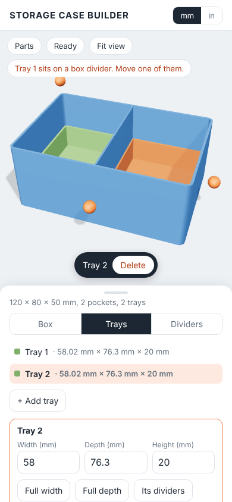

# Storage Case Builder

Design a 3D-printable storage case on your phone, without CAD. Set the size, drop in trays and dividers, drag them where you want them, add a lid, and download STL files ready to slice and print.

**Use it:** https://pjw3211.github.io/Storage-Case/

## What it does now

It works like a small CAD assembly: every part is a model on screen that you tap to pick and drag to move. The round orange handles sit on whatever is picked (the box, or a tray) and resize it. Dragged sizes stick at every 10 mm across and every 5 mm up; typed sizes stay exact.

1. **Parts list.** On the left (behind the Parts button on a phone): the box, each tray, and the dividers in each. Tap one to pick it.
2. **Box tab.** Width, depth and height (or drag the round orange handles), wall, floor and divider thickness, corner radius, and the lid.
3. **Trays tab.** Add lift-out trays of any size. Drag a tray around inside the box: when you let go it locks against at least two sides, the walls or other trays. Drop it on another tray to stack it on top. Full width and Full depth stretch it to the walls, and Copy tray adds a copy, dividers and all.
4. **Dividers tab.** Choose the box or a tray, then add front-to-back or side-to-side dividers. Drag one anywhere: it lines up with other dividers, and its ends snap to the walls and to dividers they meet. Tap one to drag its end dots, turn it 90°, stretch it wall to wall, copy it, or lower it for finger access.
5. **Slot-in dividers.** By default each divider prints flat as a separate piece and slides into a channel: a pair of low ribs along the floor and upright ribs on the walls, which move wherever you put the divider. Crossing dividers get matching halfway notches so they slot together. Switch to "Printed in" on the Dividers tab to print them as part of the box instead.
6. **Quick delete.** Whatever is picked shows a Delete button at the bottom of the view.
7. **Lid.** None, or a lift-off lid with a lip that sits inside the walls; dividers and trays stop below the lip.
8. **Download and share.** One STL per part (box, lid, each tray, and the dividers of each), each laid flat on the bed. Share a link that opens the same design, or save it as a design file and open it again later.

Units switch between millimetres and inches at the top right. Your design is saved in the browser.

The print rules (wall 0.8–5 mm, pockets at least 5 mm wide, sizes up to 300 × 300 × 250 mm) keep every design printable.

## Coming next

Mounting hardware presets and custom holes, stand-in objects to check fit, 3MF download and printer bed checks. The full plan is in the [version 1 spec](https://claude.ai/artifact/Tf282aTvgj7t2fVYiMJ5nk).

## For developers

Requires Node 22.

    npm install
    npm run dev        # local site at http://localhost:5173
    npm test           # the design rules and the exact solids
    npm run test:e2e   # opens the app on a phone-sized screen, drags trays, dividers and handles, shares and downloads

| Folder | Contents |
| --- | --- |
| `index.html`, `src/main.js` | The app: parts list, tabs, saving, sharing, downloads |
| `src/design.js` | A design as plain data (mm) and the print rules: limits, placing dividers and trays |
| `src/view.js` | The three.js view: every part as a model you can pick and drag, and the resize handles |
| `src/cad/` | Exact solid engine (OpenCascade via [replicad](https://replicad.xyz), in a web worker): `case.js` builds the box, trays and lid, `exports.js` the meshes and STL. Millimetres, Z up, front faces -Y |
| `tests/`, `e2e/` | Tests for the rules and solids, browser tests for the app |
